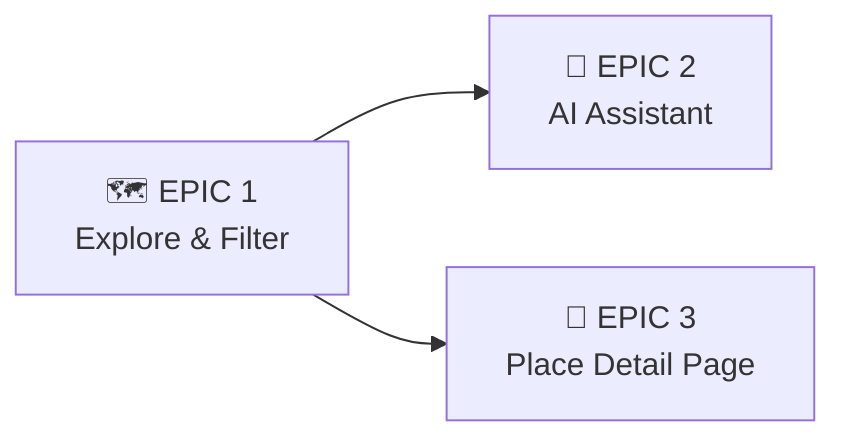

# 🗂️ TuniVerse — MVP Product Backlog

> **Methodology:** Agile / Scrum
> **Scope:** MVP (English only, no Docker)
> **Estimation:** Story Points (Fibonacci — 1, 2, 3, 5, 8, 13)

---

## 📦 Epics Overview

| # | Epic | Description |
|---|---|---|
| E1 | **Explore & Filter** | Filter places by category/city, see results as cards + map dots sorted by recommendation |
| E2 | **AI Assistant Panel** | In-page RAG chatbot to help the user decide on a place |
| E3 | **Place Detail Page** | Full detail view opened when clicking a suggested place |

---

---

## 🗺️ EPIC 1 — Explore & Filter Page

> *"As a user, I can filter places based on category, city, etc. and see the filtered results as place cards (name, photo, brief description) beside the map, and as dots on the map — sorted by a recommendation system (most to least suggested for me)."*

---

### US-1.1 — Filter Bar

**As a user, I can filter Tunisian places by category and city so that I see only relevant results.**

**Acceptance Criteria:**
- [ ] A filter bar is visible at the top of the Explore page
- [ ] Filters available: **Category** (monument, beach, museum, restaurant, nature…) and **City / Governorate**
- [ ] Filters can be combined (e.g., "Beach" + "Sousse")
- [ ] Selecting a filter immediately updates both the card list and the map dots
- [ ] An active filter shows a visible badge/tag with an ✕ to remove it
- [ ] A "Clear all filters" button resets everything

**Technical Tasks:**
| # | Task | Layer | SP |
|---|---|---|---|
| T1.1.1 | Create `GET /api/v1/places` endpoint with query params: `category`, `city`, `limit`, `offset` | Backend | 3 |
| T1.1.2 | Add `category` and `city` indexed columns to `Place` SQLAlchemy model | Backend | 2 |
| T1.1.3 | Build `FilterBar` React component with dropdowns/chips for category & city | Frontend | 3 |
| T1.1.4 | Wire filter state to API call with debounced re-fetch on change | Frontend | 2 |
| T1.1.5 | Seed the DB with at least 30 real Tunisian places across 5+ categories | Data | 5 |

**Story Points Total: 15** | **Priority: 🔴 Must Have**

---

### US-1.2 — Place Cards List

**As a user, I see filtered places as cards showing the place name, a photo, and a brief description, displayed beside the map.**

**Acceptance Criteria:**
- [ ] Cards are displayed in a scrollable vertical panel on the **left side** of the page
- [ ] Each card shows: **thumbnail photo**, **place name**, **city**, **category badge**, and **1-line description**
- [ ] Cards are ordered from **most recommended** to least (based on recommendation score)
- [ ] Hovering a card highlights its corresponding dot on the map
- [ ] Clicking a card opens the Place Detail page (Epic 3)
- [ ] If no results match the filter, a friendly empty state is shown

**Technical Tasks:**
| # | Task | Layer | SP |
|---|---|---|---|
| T1.2.1 | Design `PlaceCard` React component (photo, name, city, category, description) | Frontend | 2 |
| T1.2.2 | Build scrollable `PlaceCardList` panel layout beside the map | Frontend | 2 |
| T1.2.3 | Add `recommendation_score` field to `Place` model (float, default 0.5) | Backend | 1 |
| T1.2.4 | Sort API response by `recommendation_score DESC` by default | Backend | 1 |
| T1.2.5 | Implement card ↔ map dot hover sync via shared React state | Frontend | 3 |

**Story Points Total: 9** | **Priority: 🔴 Must Have**

---

### US-1.3 — Map with Place Dots

**As a user, I see filtered places as dots on an interactive map, sorted visually by recommendation (most recommended = more prominent dot).**

**Acceptance Criteria:**
- [ ] A Leaflet/OpenStreetMap map occupies the **right side** of the Explore page
- [ ] Each place is shown as a **dot/marker** at its GPS coordinates
- [ ] Dot size or color reflects recommendation rank (top recommended = larger/brighter dot)
- [ ] Clicking a dot on the map highlights the matching card in the left panel and opens a small popup with place name + photo
- [ ] Map auto-fits bounds when filters change
- [ ] Map is responsive and touch-friendly

**Technical Tasks:**
| # | Task | Layer | SP |
|---|---|---|---|
| T1.3.1 | Add `latitude` and `longitude` columns to `Place` model | Backend | 1 |
| T1.3.2 | Include `lat`, `lng`, `recommendation_score` in places API response | Backend | 1 |
| T1.3.3 | Integrate `react-leaflet` and render markers from API response | Frontend | 3 |
| T1.3.4 | Style markers dynamically based on `recommendation_score` (size/color scale) | Frontend | 3 |
| T1.3.5 | Implement map popup (mini card: name + photo) on marker click | Frontend | 2 |
| T1.3.6 | Implement `fitBounds` on filter change | Frontend | 2 |

**Story Points Total: 12** | **Priority: 🔴 Must Have**

---

### US-1.4 — Recommendation System (Basic)

**As a user, places are ranked and sorted based on a recommendation score tailored to my context.**

**Acceptance Criteria:**
- [ ] For MVP: score is based on **popularity** (view count / interaction count) — no personalization needed yet
- [ ] Score is recomputed periodically or on each place view
- [ ] Most recommended places appear first in the card list and have more prominent map markers

> [!NOTE]
> Full personalized recommendation (collaborative filtering, user history) is a **v2** feature. MVP uses a simple popularity-based score.

**Technical Tasks:**
| # | Task | Layer | SP |
|---|---|---|---|
| T1.4.1 | Add `view_count` counter to `Place` model | Backend | 1 |
| T1.4.2 | Increment `view_count` on each place detail fetch | Backend | 1 |
| T1.4.3 | Compute `recommendation_score = view_count / max_view_count` (normalized 0–1) | Backend | 2 |
| T1.4.4 | *(v2)* Personalized collaborative filtering based on user history | Backend | — |

**Story Points Total: 4** | **Priority: 🟡 Should Have**

---

---

## 🤖 EPIC 2 — AI Assistant Panel (In-Page RAG Chatbot)

> *"As a user, I can talk on the same Explore page to an AI assistant that helps me decide on a place, powered by RAG."*

---

### US-2.1 — AI Chat Panel UI

**As a user, I see an AI assistant chat panel on the Explore page so that I can ask questions without leaving the page.**

**Acceptance Criteria:**
- [ ] A collapsible chat panel is visible on the Explore page (bottom or side panel)
- [ ] The panel has a text input, a send button, and a scrollable message history
- [ ] The assistant's replies stream in token by token (SSE streaming)
- [ ] User messages appear on the right, assistant messages on the left
- [ ] A "suggested prompts" row is shown when the chat is empty (e.g., *"What's the best beach near Sousse?"*, *"Recommend a family-friendly activity"*)
- [ ] The panel is resizable or togglable (open/close)

**Technical Tasks:**
| # | Task | Layer | SP |
|---|---|---|---|
| T2.1.1 | Build `AIChatPanel` component with message list, input bar, send button | Frontend | 5 |
| T2.1.2 | Implement SSE streaming consumer using the existing `useStreamingChat` hook | Frontend | 3 |
| T2.1.3 | Add suggested starter prompts component | Frontend | 2 |
| T2.1.4 | Make panel collapsible (toggle button) | Frontend | 1 |

**Story Points Total: 11** | **Priority: 🔴 Must Have**

---

### US-2.2 — RAG Backend for Tourism Chatbot

**As a user, the AI assistant answers my questions about Tunisian places using verified knowledge base data (not hallucinated).**

**Acceptance Criteria:**
- [ ] `POST /api/v1/chat/stream` endpoint returns an SSE stream of text tokens
- [ ] The RAG pipeline retrieves the top-K most relevant places from pgvector based on the user's query
- [ ] The LLM is prompted with retrieved context and must only answer based on that context
- [ ] If no relevant context is found, the assistant says so honestly instead of guessing
- [ ] The assistant can reference specific places by name and suggest them to the user
- [ ] Response time under 3 seconds to first token

**Technical Tasks:**
| # | Task | Layer | SP |
|---|---|---|---|
| T2.2.1 | Set up pgvector extension and add `embedding` vector column to `Place` model | Backend | 3 |
| T2.2.2 | Generate and store embeddings for all places in the DB (batch script) | Data/Backend | 5 |
| T2.2.3 | Build RAG retrieval function: embed query → cosine similarity search → top-K places | Backend | 5 |
| T2.2.4 | Build LLM prompt template with retrieved context + system instructions | Backend | 3 |
| T2.2.5 | Implement SSE streaming endpoint `POST /api/v1/chat/stream` | Backend | 5 |
| T2.2.6 | Add prompt injection guardrails (refuse off-topic or harmful queries) | Backend | 2 |

**Story Points Total: 23** | **Priority: 🔴 Must Have**

---

### US-2.3 — Chat Influences Map & Cards

**As a user, when the AI assistant recommends specific places, those places get highlighted on the map and in the cards list.**

**Acceptance Criteria:**
- [ ] When the assistant mentions a place by name, its card is scrolled into view in the left panel
- [ ] The map marker for that place pulses or changes color briefly
- [ ] The assistant response includes a clickable reference card for each mentioned place

**Technical Tasks:**
| # | Task | Layer | SP |
|---|---|---|---|
| T2.3.1 | Parse assistant response for place names (match against DB names) | Frontend/Backend | 3 |
| T2.3.2 | Emit highlighted place IDs from chat state to map/card components | Frontend | 3 |
| T2.3.3 | Add CSS pulse animation to highlighted map markers | Frontend | 1 |

**Story Points Total: 7** | **Priority: 🟡 Should Have**

---

---

## 📍 EPIC 3 — Place Detail Page

> *"As a user, I can click on a suggested place and a new page appears with full details, descriptions, and images of that place."*

---

### US-3.1 — Place Detail Page Layout

**As a user, clicking on a place card or map dot navigates me to a dedicated page with all information about that place.**

**Acceptance Criteria:**
- [ ] Route: `/place/:id` — navigates to the detail page
- [ ] Page includes: **hero image gallery** (multiple photos), **place name**, **category badge**, **city/region**, **full description**, **practical info** (opening hours, estimated cost, visit duration)
- [ ] A **back button** returns to the Explore page with filters preserved
- [ ] The page has a **small embedded map** showing only that place's location
- [ ] Page is fully responsive on mobile

**Technical Tasks:**
| # | Task | Layer | SP |
|---|---|---|---|
| T3.1.1 | Create `GET /api/v1/places/:id` endpoint returning full place details | Backend | 2 |
| T3.1.2 | Add fields to `Place` model: `images[]`, `opening_hours`, `visit_duration_min`, `cost_estimate` | Backend | 2 |
| T3.1.3 | Build `PlaceDetailPage` React component and register `/place/:id` route | Frontend | 3 |
| T3.1.4 | Build image gallery / carousel component | Frontend | 3 |
| T3.1.5 | Embed a small Leaflet map with single marker for this place | Frontend | 2 |
| T3.1.6 | Implement "back to Explore" with filter state preserved (React Router state) | Frontend | 2 |

**Story Points Total: 14** | **Priority: 🔴 Must Have**

---

### US-3.2 — Similar Places Suggestions

**As a user, I see similar or nearby places at the bottom of the detail page so I can discover more.**

**Acceptance Criteria:**
- [ ] A "You might also like" section shows 3–4 place cards at the bottom
- [ ] Suggestions are based on same category OR same city
- [ ] Each suggestion card is clickable and navigates to that place's detail page

**Technical Tasks:**
| # | Task | Layer | SP |
|---|---|---|---|
| T3.2.1 | Add `GET /api/v1/places/:id/similar` endpoint (filter by same category or city, exclude current) | Backend | 3 |
| T3.2.2 | Build "Similar Places" row component using the existing `PlaceCard` component | Frontend | 2 |

**Story Points Total: 5** | **Priority: 🟢 Nice to Have**

---

---

## 📊 Backlog Summary

| Epic | User Story | SP | Priority | Status |
|---|---|---|---|---|
| E1 | US-1.1 Filter Bar | 15 | 🔴 Must Have | 🔲 To Do |
| E1 | US-1.2 Place Cards List | 9 | 🔴 Must Have | 🔲 To Do |
| E1 | US-1.3 Map with Dots | 12 | 🔴 Must Have | 🔲 To Do |
| E1 | US-1.4 Recommendation System | 4 | 🟡 Should Have | 🔲 To Do |
| E2 | US-2.1 AI Chat Panel UI | 11 | 🔴 Must Have | 🔲 To Do |
| E2 | US-2.2 RAG Backend | 23 | 🔴 Must Have | 🔲 To Do |
| E2 | US-2.3 Chat → Map Highlight | 7 | 🟡 Should Have | 🔲 To Do |
| E3 | US-3.1 Place Detail Page | 14 | 🔴 Must Have | 🔲 To Do |
| E3 | US-3.2 Similar Places | 5 | 🟢 Nice to Have | 🔲 To Do |
| | **TOTAL** | **100 SP** | | |

---

## 🏃 Suggested Sprint Plan

| Sprint | User Stories | SP | Focus |
|---|---|---|---|
| **Sprint 1** | US-1.1 + US-1.4 + T1.3.1–T1.3.2 (data foundation) | ~20 | Backend models, DB seed, filter API |
| **Sprint 2** | US-1.2 + US-1.3 | ~21 | Cards list + Map UI |
| **Sprint 3** | US-2.2 (RAG backend) | ~23 | RAG pipeline + SSE streaming |
| **Sprint 4** | US-2.1 + US-3.1 | ~25 | Chat UI + Place Detail page |
| **Sprint 5** | US-2.3 + US-3.2 + polish | ~12 | Chat↔Map sync, similar places, bug fixes |
