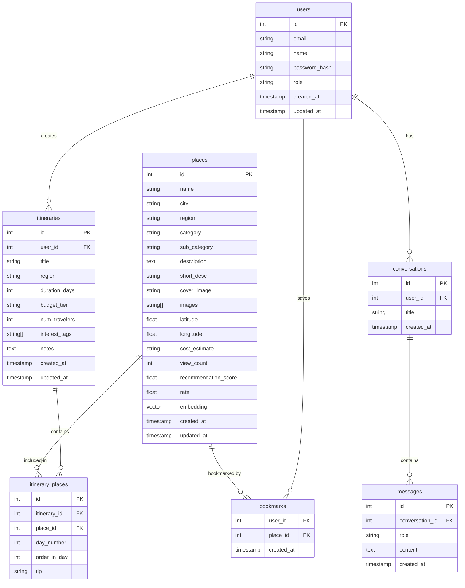

# 🗄️ TuniVerse — Database Schema

> **Engine:** PostgreSQL 19 hosted on **Supabase** (https://supabase.com)
> **ORM:** SQLAlchemy 2.0
> **Migration:** Alembic
> **Connection:** Session pooler — both team members use the same `DATABASE_URL` from Supabase

> [!NOTE]
> The `places` table is already created on Supabase via `alembic upgrade head`.
> Other tables will be added in later sprints as new models are registered in `base.py`.

---

## ER Diagram



---

## Tables

---

### `users`
> Registered users and administrators.

| Column | Type | Constraints | Notes |
|---|---|---|---|
| `id` | `SERIAL` | PK | Auto-increment |
| `email` | `VARCHAR(255)` | UNIQUE, NOT NULL, INDEX | Login identifier |
| `name` | `VARCHAR(100)` | NOT NULL | Display name |
| `password_hash` | `VARCHAR(255)` | NOT NULL | bcrypt hash — never store plaintext |
| `role` | `VARCHAR(20)` | NOT NULL, DEFAULT `'user'` | `'user'` or `'admin'` |
| `created_at` | `TIMESTAMP` | DEFAULT `now()` | |
| `updated_at` | `TIMESTAMP` | DEFAULT `now()` | |

**Indexes:** `email` (unique)

---

### `places`
> Core tourism knowledge base — Tunisian attractions, monuments, beaches, etc.

| Column | Type | Constraints | Notes |
|---|---|---|---|
| `id` | `SERIAL` | PK | |
| `name` | `VARCHAR(200)` | NOT NULL | Place name |
| `city` | `VARCHAR(100)` | NOT NULL, INDEX | e.g. `"Tunis"`, `"Sousse"` |
| `region` | `VARCHAR(100)` | NOT NULL | e.g. `"Greater Tunis"` |
| `category` | `VARCHAR(50)` | NOT NULL, INDEX | See enum below |
| `sub_category` | `VARCHAR(100)` | INDEX | Finer-grained type within a category — see examples below |
| `description` | `TEXT` | NOT NULL | Full rich description (used by RAG) |
| `short_desc` | `VARCHAR(300)` | NOT NULL | 1-line summary shown on cards |
| `cover_image` | `VARCHAR(500)` | | URL of main photo |
| `images` | `TEXT[]` | DEFAULT `'{}'` | Array of extra photo URLs |
| `latitude` | `FLOAT` | NOT NULL | GPS coordinates |
| `longitude` | `FLOAT` | NOT NULL | GPS coordinates |
| `cost_estimate` | `VARCHAR(100)` | | e.g. `"Free"`, `"5–10 TND"` |
| `view_count` | `INTEGER` | NOT NULL, DEFAULT `0` | Incremented on each detail view |
| `recommendation_score` | `FLOAT` | NOT NULL, DEFAULT `0.5` | Normalized 0–1, computed from `view_count` |
| `rate` | `FLOAT` | CHECK `0.0 ≤ rate ≤ 5.0`, DEFAULT `0.0` | Average user rating (1–5 stars) |
| `embedding` | `vector(1536)` | nullable | pgvector — added in Sprint 3 (RAG) |
| `created_at` | `TIMESTAMP` | DEFAULT `now()` | |
| `updated_at` | `TIMESTAMP` | DEFAULT `now()` | |

**Indexes:**
- `city` — fast city filter
- `category` — fast category filter
- `sub_category` — fast sub-category filter
- `recommendation_score DESC` — fast sorted listing
- `embedding` using `ivfflat` (cosine) — fast vector search *(Sprint 3)*

**Category + Sub-category examples:**

| `category` | `sub_category` examples |
|---|---|
| `monument` | `roman`, `islamic`, `prehistoric`, `colonial` |
| `beach` | `sandy`, `rocky`, `family`, `water-sports` |
| `museum` | `archaeology`, `art`, `history`, `science` |
| `nature` | `national-park`, `desert`, `lake`, `mountain`, `oasis` |
| `restaurant` | `traditional`, `seafood`, `street-food`, `fine-dining` |
| `cultural` | `medina`, `souk`, `village`, `festival` |
| `wellness` | `hot-springs`, `hammam`, `spa` |
| `activity` | `camel-ride`, `quad`, `diving`, `hiking` |

---

### `itineraries`
> Personalized day-by-day travel plans, generated by AI or saved by users.

| Column | Type | Constraints | Notes |
|---|---|---|---|
| `id` | `SERIAL` | PK | |
| `user_id` | `INTEGER` | FK → `users.id`, nullable | NULL = guest preview (not saved) |
| `title` | `VARCHAR(200)` | NOT NULL | e.g. `"3 Days in Northern Tunisia"` |
| `region` | `VARCHAR(100)` | NOT NULL | Target travel region |
| `duration_days` | `INTEGER` | NOT NULL | e.g. `3` |
| `budget_tier` | `VARCHAR(20)` | NOT NULL | `'budget'` · `'mid'` · `'luxury'` |
| `num_travelers` | `INTEGER` | DEFAULT `1` | |
| `interest_tags` | `TEXT[]` | DEFAULT `'{}'` | e.g. `{history, food, beaches}` |
| `notes` | `TEXT` | | LLM-generated intro/summary paragraph |
| `created_at` | `TIMESTAMP` | DEFAULT `now()` | |
| `updated_at` | `TIMESTAMP` | DEFAULT `now()` | |

**Indexes:** `user_id`

---

### `itinerary_places` *(junction)*
> Ordered stops inside an itinerary, organized by day.

| Column | Type | Constraints | Notes |
|---|---|---|---|
| `id` | `SERIAL` | PK | |
| `itinerary_id` | `INTEGER` | FK → `itineraries.id`, CASCADE DELETE | |
| `place_id` | `INTEGER` | FK → `places.id` | |
| `day_number` | `INTEGER` | NOT NULL | Which day (1, 2, 3…) |
| `order_in_day` | `INTEGER` | NOT NULL | Order within that day (1 = morning…) |
| `tip` | `VARCHAR(500)` | | LLM-generated practical tip for this stop |

**Indexes:** `(itinerary_id, day_number, order_in_day)` — for fast ordered fetch

---

### `conversations`
> Chat sessions between a user and the AI assistant.

| Column | Type | Constraints | Notes |
|---|---|---|---|
| `id` | `SERIAL` | PK | |
| `user_id` | `INTEGER` | FK → `users.id`, nullable | NULL = anonymous guest session |
| `title` | `VARCHAR(200)` | | Auto-generated from first user message |
| `created_at` | `TIMESTAMP` | DEFAULT `now()` | |

**Indexes:** `user_id`

---

### `messages`
> Individual chat messages inside a conversation.

| Column | Type | Constraints | Notes |
|---|---|---|---|
| `id` | `SERIAL` | PK | |
| `conversation_id` | `INTEGER` | FK → `conversations.id`, CASCADE DELETE | |
| `role` | `VARCHAR(10)` | NOT NULL | `'user'` or `'assistant'` |
| `content` | `TEXT` | NOT NULL | Message text |
| `created_at` | `TIMESTAMP` | DEFAULT `now()` | |

**Indexes:** `conversation_id`

---

### `bookmarks`
> Places saved/favourited by a user.

| Column | Type | Constraints | Notes |
|---|---|---|---|
| `user_id` | `INTEGER` | FK → `users.id`, CASCADE DELETE | Composite PK |
| `place_id` | `INTEGER` | FK → `places.id`, CASCADE DELETE | Composite PK |
| `created_at` | `TIMESTAMP` | DEFAULT `now()` | |

**Primary Key:** `(user_id, place_id)` — prevents duplicate bookmarks

---

## Relationships Summary

| Relationship | Type | Note |
|---|---|---|
| `users` → `itineraries` | 1 : N | A user can save many itineraries |
| `users` → `conversations` | 1 : N | A user can have many chat sessions |
| `users` → `bookmarks` | 1 : N | A user can bookmark many places |
| `itineraries` ↔ `places` | M : N | Via `itinerary_places` (with day + order) |
| `conversations` → `messages` | 1 : N | A conversation has many messages |
| `places` → `bookmarks` | 1 : N | A place can be bookmarked by many users |

---

## Sprint Rollout Plan

> [!IMPORTANT]
> Don't add `embedding` column yet — it requires pgvector setup and an embedding model. Add it in Sprint 3.

| Sprint | Tables to create | Notes |
|---|---|---|
| **Sprint 1** | `places` *(without `embedding`)* ✅ **Done on Supabase** | Core data + filter API |
| **Sprint 2** | — | Frontend uses existing schema |
| **Sprint 3** | Add `embedding` to `places`, `conversations`, `messages` | RAG pipeline — enable pgvector on Supabase |
| **Sprint 4** | `users` | JWT auth |
| **Sprint 4** | `bookmarks`, `itineraries`, `itinerary_places` | Saving features |

---

## Quick Reference — Category & Sub-category Values

```python
CATEGORIES = [
    "monument",   # Carthage, El Jem, Dougga
    "beach",      # Hammamet, Djerba, Zarzis
    "museum",     # Bardo, Sousse Museum
    "nature",     # Ichkeul, Chott el-Djerid, Sahara
    "restaurant", # Local gastronomy spots
    "cultural",   # Sidi Bou Said, medinas
    "wellness",   # Korbous hot springs
    "activity",   # Camel rides, water sports
]

SUB_CATEGORIES = {
    "monument":   ["roman", "islamic", "prehistoric", "colonial"],
    "beach":      ["sandy", "rocky", "family", "water-sports"],
    "museum":     ["archaeology", "art", "history", "science"],
    "nature":     ["national-park", "desert", "lake", "mountain", "oasis"],
    "restaurant": ["traditional", "seafood", "street-food", "fine-dining"],
    "cultural":   ["medina", "souk", "village", "festival"],
    "wellness":   ["hot-springs", "hammam", "spa"],
    "activity":   ["camel-ride", "quad", "diving", "hiking"],
}
```
