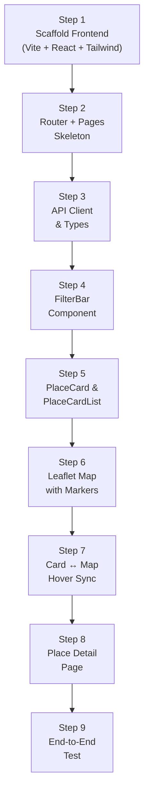

# 🏃 Sprint 2 — Step-by-Step Plan

**Goal:** Build the entire Explore page — FilterBar, PlaceCard list, Leaflet map, and Place Detail page — wired to the Sprint 1 API.  
**Stories:** US-1.2 (Place Cards List) + US-1.3 (Map with Dots) + US-3.1 (Place Detail Page)  
**Output:** A fully functional Explore page at `/explore` where a user can filter Tunisian places, see them as cards and map markers, and click through to a detail page.

---

## Overview



---

## Step 1 — Scaffold the Frontend

### 1.1 Initialize the Vite + React + TypeScript project

```bash
# From the TuniVerse/ root (not inside frontend/)
npm create vite@latest frontend -- --template react-ts
cd frontend
npm install
```

### 1.2 Install all dependencies

```bash
npm install \
  react-router-dom \
  @tanstack/react-query \
  axios \
  react-leaflet leaflet \
  @types/leaflet \
  tailwindcss postcss autoprefixer \
  lucide-react \
  clsx
```

> **Why these packages:**
> - `react-router-dom` — client-side routing (`/explore`, `/place/:id`)
> - `@tanstack/react-query` — server state, caching, automatic re-fetching on filter change
> - `axios` — HTTP client with a shared base URL config
> - `react-leaflet` + `leaflet` — interactive map (OpenStreetMap tiles, free, no API key)
> - `tailwindcss` — utility CSS (already in the stack)
> - `lucide-react` — icon set consistent with shadcn/ui
> - `clsx` — conditional className utility

### 1.3 Initialize Tailwind

```bash
npx tailwindcss init -p
```

Fill `tailwind.config.js`:

```js
/** @type {import('tailwindcss').Config} */
export default {
  content: ["./index.html", "./src/**/*.{ts,tsx}"],
  theme: {
    extend: {
      colors: {
        // TuniVerse brand palette
        primary: "#1a7f5a",   // Tunisian green
        accent:  "#e8a020",   // warm gold
      },
    },
  },
  plugins: [],
}
```

Add to `src/index.css`:

```css
@tailwind base;
@tailwind components;
@tailwind utilities;
```

### 1.4 Fill `index.html` title

```html
<!doctype html>
<html lang="en">
  <head>
    <meta charset="UTF-8" />
    <meta name="viewport" content="width=device-width, initial-scale=1.0" />
    <title>TuniVerse — Explore Tunisia</title>
  </head>
  <body>
    <div id="root"></div>
    <script type="module" src="/src/main.tsx"></script>
  </body>
</html>
```

### 1.5 Fill `vite.config.ts`

```ts
import { defineConfig } from "vite";
import react from "@vitejs/plugin-react";

export default defineConfig({
  plugins: [react()],
  server: {
    port: 5173,
    proxy: {
      "/api": "http://localhost:8000",   // forward API calls to FastAPI
    },
  },
});
```

> The proxy means the frontend calls `/api/v1/places` and Vite forwards it to `http://localhost:8000/api/v1/places` — no CORS issues in dev.

**✅ Check:** `npm run dev` → browser opens at `http://localhost:5173`

---

## Step 2 — Router and Page Skeletons

### 2.1 Fill `src/main.tsx`

```tsx
import React from "react";
import ReactDOM from "react-dom/client";
import { BrowserRouter } from "react-router-dom";
import { QueryClient, QueryClientProvider } from "@tanstack/react-query";
import App from "./App";
import "./index.css";

const queryClient = new QueryClient();

ReactDOM.createRoot(document.getElementById("root")!).render(
  <React.StrictMode>
    <QueryClientProvider client={queryClient}>
      <BrowserRouter>
        <App />
      </BrowserRouter>
    </QueryClientProvider>
  </React.StrictMode>
);
```

### 2.2 Fill `src/App.tsx`

```tsx
import { Routes, Route, Navigate } from "react-router-dom";
import ExplorePage from "./pages/Explore";
import PlaceDetailPage from "./pages/PlaceDetail";

export default function App() {
  return (
    <Routes>
      <Route path="/" element={<Navigate to="/explore" replace />} />
      <Route path="/explore" element={<ExplorePage />} />
      <Route path="/place/:id" element={<PlaceDetailPage />} />
    </Routes>
  );
}
```

> `Home`, `Dashboard`, `Admin`, `Chat` pages are stubbed for now — Sprint 2 focuses on Explore + Detail.

### 2.3 Create page skeletons

**`src/pages/Explore/index.tsx`**

```tsx
export default function ExplorePage() {
  return <div className="h-screen flex items-center justify-center">Explore — coming soon</div>;
}
```

**`src/pages/PlaceDetail/index.tsx`**

```tsx
export default function PlaceDetailPage() {
  return <div className="h-screen flex items-center justify-center">Place Detail — coming soon</div>;
}
```

**✅ Check:** `http://localhost:5173/explore` shows the placeholder. Routing works.

---

## Step 3 — API Client and TypeScript Types

### 3.1 Fill `src/types/index.ts`

```ts
export interface PlaceCard {
  id: number;
  name: string;
  city: string;
  region: string;
  category: string;
  sub_category: string | null;
  short_desc: string;
  cover_image: string | null;
  latitude: number;
  longitude: number;
  rate: number;
  view_count: number;
  recommendation_score: number;
}

export interface PlaceDetail extends PlaceCard {
  description: string;
  images: string[];
  cost_estimate: string | null;
}

export interface PlacesResponse {
  total: number;
  places: PlaceCard[];
}

export interface FilterOptions {
  cities: string[];
  categories: string[];
  sub_categories: string[];
}

export interface PlaceFilters {
  category: string;
  sub_category: string;
  city: string;
  search: string;
}
```

### 3.2 Fill `src/config/api.ts`

```ts
import axios from "axios";
import type { PlacesResponse, PlaceDetail, FilterOptions, PlaceFilters } from "../types";

const api = axios.create({
  baseURL: "/api/v1",
});

export const placesApi = {
  getPlaces: (filters: Partial<PlaceFilters>, limit = 100, offset = 0) =>
    api
      .get<PlacesResponse>("/places", {
        params: {
          ...filters,
          limit,
          offset,
        },
      })
      .then((r) => r.data),

  getPlace: (id: number) =>
    api.get<PlaceDetail>(`/places/${id}`).then((r) => r.data),

  getFilters: () =>
    api.get<FilterOptions>("/places/filters").then((r) => r.data),
};
```

### 3.3 Create `src/hooks/usePlaces.ts`

```ts
import { useQuery } from "@tanstack/react-query";
import { placesApi } from "../config/api";
import type { PlaceFilters } from "../types";

export function usePlaces(filters: Partial<PlaceFilters>) {
  return useQuery({
    queryKey: ["places", filters],
    queryFn: () => placesApi.getPlaces(filters),
    staleTime: 1000 * 30, // cache for 30 seconds
  });
}

export function usePlace(id: number) {
  return useQuery({
    queryKey: ["place", id],
    queryFn: () => placesApi.getPlace(id),
    enabled: id > 0,
  });
}

export function useFilterOptions() {
  return useQuery({
    queryKey: ["filterOptions"],
    queryFn: placesApi.getFilters,
    staleTime: 1000 * 60 * 10, // cache for 10 minutes — these rarely change
  });
}
```

> React Query's `queryKey: ["places", filters]` means every unique combination of filters gets its own cache entry. When a filter changes, the page refetches automatically with no manual `useEffect` needed.

---

## Step 4 — FilterBar Component

### 4.1 Create `src/components/FilterBar/index.tsx`

```tsx
import { useSearchParams } from "react-router-dom";
import { X } from "lucide-react";
import { useFilterOptions } from "../../hooks/usePlaces";
import type { PlaceFilters } from "../../types";

interface FilterBarProps {
  filters: PlaceFilters;
  onChange: (filters: PlaceFilters) => void;
}

export default function FilterBar({ filters, onChange }: FilterBarProps) {
  const { data: options } = useFilterOptions();

  const set = (key: keyof PlaceFilters, value: string) =>
    onChange({ ...filters, [key]: value });

  const clear = () =>
    onChange({ category: "", sub_category: "", city: "", search: "" });

  const hasActiveFilters =
    filters.category || filters.sub_category || filters.city || filters.search;

  return (
    <div className="flex flex-wrap items-center gap-3 p-4 bg-white border-b shadow-sm">
      {/* Search */}
      <div className="relative">
        <input
          type="text"
          placeholder="Search places…"
          value={filters.search}
          onChange={(e) => set("search", e.target.value)}
          className="border rounded-lg px-3 py-2 text-sm w-52 focus:outline-none focus:ring-2 focus:ring-primary"
        />
        {filters.search && (
          <button
            onClick={() => set("search", "")}
            className="absolute right-2 top-1/2 -translate-y-1/2 text-gray-400 hover:text-gray-600"
          >
            <X size={14} />
          </button>
        )}
      </div>

      {/* Category */}
      <select
        value={filters.category}
        onChange={(e) => set("category", e.target.value)}
        className="border rounded-lg px-3 py-2 text-sm focus:outline-none focus:ring-2 focus:ring-primary"
      >
        <option value="">All Categories</option>
        {options?.categories.map((c) => (
          <option key={c} value={c}>
            {c.charAt(0).toUpperCase() + c.slice(1)}
          </option>
        ))}
      </select>

      {/* Sub-category */}
      <select
        value={filters.sub_category}
        onChange={(e) => set("sub_category", e.target.value)}
        className="border rounded-lg px-3 py-2 text-sm focus:outline-none focus:ring-2 focus:ring-primary"
      >
        <option value="">All Types</option>
        {options?.sub_categories.map((s) => (
          <option key={s} value={s}>
            {s.charAt(0).toUpperCase() + s.slice(1)}
          </option>
        ))}
      </select>

      {/* City */}
      <select
        value={filters.city}
        onChange={(e) => set("city", e.target.value)}
        className="border rounded-lg px-3 py-2 text-sm focus:outline-none focus:ring-2 focus:ring-primary"
      >
        <option value="">All Cities</option>
        {options?.cities.map((c) => (
          <option key={c} value={c}>
            {c}
          </option>
        ))}
      </select>

      {/* Active filter badges */}
      <div className="flex flex-wrap gap-2 ml-2">
        {filters.category && (
          <FilterBadge label={filters.category} onRemove={() => set("category", "")} />
        )}
        {filters.sub_category && (
          <FilterBadge label={filters.sub_category} onRemove={() => set("sub_category", "")} />
        )}
        {filters.city && (
          <FilterBadge label={filters.city} onRemove={() => set("city", "")} />
        )}
      </div>

      {/* Clear all */}
      {hasActiveFilters && (
        <button
          onClick={clear}
          className="ml-auto text-sm text-gray-500 hover:text-red-500 underline"
        >
          Clear all
        </button>
      )}
    </div>
  );
}

function FilterBadge({ label, onRemove }: { label: string; onRemove: () => void }) {
  return (
    <span className="flex items-center gap-1 bg-primary/10 text-primary text-xs font-medium px-2 py-1 rounded-full">
      {label}
      <button onClick={onRemove} className="hover:text-red-500">
        <X size={11} />
      </button>
    </span>
  );
}
```

> **Filter state lives in the URL** (see Step 5.3). The `FilterBar` is a controlled component — it gets current filter state as props and calls `onChange`. The parent (Explore page) owns the state and syncs it to URL params.

---

## Step 5 — PlaceCard and PlaceCardList

### 5.1 Create `src/components/PlaceCard/index.tsx`

```tsx
import { useNavigate } from "react-router-dom";
import { MapPin, Star } from "lucide-react";
import clsx from "clsx";
import type { PlaceCard as PlaceCardType } from "../../types";

const CATEGORY_COLORS: Record<string, string> = {
  beach:       "bg-blue-100 text-blue-700",
  monument:    "bg-amber-100 text-amber-700",
  museum:      "bg-purple-100 text-purple-700",
  nature:      "bg-green-100 text-green-700",
  cultural:    "bg-rose-100 text-rose-700",
  restaurant:  "bg-orange-100 text-orange-700",
  wellness:    "bg-teal-100 text-teal-700",
};

interface PlaceCardProps {
  place: PlaceCardType;
  isHovered: boolean;
  onHover: (id: number | null) => void;
}

export default function PlaceCard({ place, isHovered, onHover }: PlaceCardProps) {
  const navigate = useNavigate();
  const categoryColor = CATEGORY_COLORS[place.category] ?? "bg-gray-100 text-gray-600";

  return (
    <div
      className={clsx(
        "flex gap-3 p-3 rounded-xl cursor-pointer transition-all border",
        isHovered
          ? "border-primary shadow-md bg-primary/5 scale-[1.01]"
          : "border-transparent hover:border-gray-200 hover:shadow-sm bg-white"
      )}
      onMouseEnter={() => onHover(place.id)}
      onMouseLeave={() => onHover(null)}
      onClick={() => navigate(`/place/${place.id}`)}
    >
      {/* Thumbnail */}
      <div className="w-20 h-20 flex-shrink-0 rounded-lg overflow-hidden bg-gray-100">
        {place.cover_image ? (
           {
              (e.target as HTMLImageElement).src = "/placeholder.jpg";
            }}
          />
        ) : (
          <div className="w-full h-full flex items-center justify-center text-gray-300 text-2xl">
            🏛️
          </div>
        )}
      </div>

      {/* Content */}
      <div className="flex flex-col justify-between flex-1 min-w-0">
        <div>
          <div className="flex items-start justify-between gap-1">
            <h3 className="font-semibold text-gray-900 text-sm leading-tight truncate">
              {place.name}
            </h3>
            <span className={clsx("text-xs font-medium px-2 py-0.5 rounded-full whitespace-nowrap", categoryColor)}>
              {place.category}
            </span>
          </div>
          <p className="text-xs text-gray-500 mt-0.5 line-clamp-2">{place.short_desc}</p>
        </div>

        <div className="flex items-center gap-3 mt-1">
          <span className="flex items-center gap-1 text-xs text-gray-500">
            <MapPin size={11} />
            {place.city}
          </span>
          {place.rate > 0 && (
            <span className="flex items-center gap-1 text-xs text-amber-600 font-medium">
              <Star size={11} className="fill-amber-400 stroke-amber-400" />
              {place.rate.toFixed(1)}
            </span>
          )}
        </div>
      </div>
    </div>
  );
}
```

### 5.2 Create `src/components/PlaceCardList/index.tsx`

```tsx
import type { PlaceCard } from "../../types";
import PlaceCardComponent from "../PlaceCard";

interface PlaceCardListProps {
  places: PlaceCard[];
  hoveredId: number | null;
  onHover: (id: number | null) => void;
  isLoading: boolean;
}

export default function PlaceCardList({
  places,
  hoveredId,
  onHover,
  isLoading,
}: PlaceCardListProps) {
  if (isLoading) {
    return (
      <div className="flex flex-col gap-3 p-3">
        {Array.from({ length: 6 }).map((_, i) => (
          <SkeletonCard key={i} />
        ))}
      </div>
    );
  }

  if (places.length === 0) {
    return (
      <div className="flex flex-col items-center justify-center h-64 text-gray-400 gap-3">
        <span className="text-5xl">🔍</span>
        <p className="text-sm font-medium">No places match your filters.</p>
        <p className="text-xs">Try clearing some filters or searching for something else.</p>
      </div>
    );
  }

  return (
    <div className="flex flex-col gap-2 p-3 overflow-y-auto h-full">
      <p className="text-xs text-gray-400 px-1 mb-1">{places.length} places found</p>
      {places.map((place) => (
        <PlaceCardComponent
          key={place.id}
          place={place}
          isHovered={hoveredId === place.id}
          onHover={onHover}
        />
      ))}
    </div>
  );
}

function SkeletonCard() {
  return (
    <div className="flex gap-3 p-3 rounded-xl border border-gray-100 animate-pulse">
      <div className="w-20 h-20 rounded-lg bg-gray-200 flex-shrink-0" />
      <div className="flex flex-col gap-2 flex-1">
        <div className="h-4 bg-gray-200 rounded w-3/4" />
        <div className="h-3 bg-gray-200 rounded w-full" />
        <div className="h-3 bg-gray-200 rounded w-2/3" />
      </div>
    </div>
  );
}
```

### 5.3 Wire up filter state to URL in `src/pages/Explore/index.tsx`

```tsx
import { useSearchParams } from "react-router-dom";
import { useState } from "react";
import FilterBar from "../../components/FilterBar";
import PlaceCardList from "../../components/PlaceCardList";
import LeafletMap from "../../components/LeafletMap";
import { usePlaces } from "../../hooks/usePlaces";
import type { PlaceFilters } from "../../types";

export default function ExplorePage() {
  const [searchParams, setSearchParams] = useSearchParams();
  const [hoveredId, setHoveredId] = useState<number | null>(null);

  // Read filter state from URL — makes links shareable and back-button work
  const filters: PlaceFilters = {
    category:     searchParams.get("category") ?? "",
    sub_category: searchParams.get("sub_category") ?? "",
    city:         searchParams.get("city") ?? "",
    search:       searchParams.get("search") ?? "",
  };

  const handleFilterChange = (newFilters: PlaceFilters) => {
    const params: Record<string, string> = {};
    if (newFilters.category)     params.category     = newFilters.category;
    if (newFilters.sub_category) params.sub_category = newFilters.sub_category;
    if (newFilters.city)         params.city         = newFilters.city;
    if (newFilters.search)       params.search       = newFilters.search;
    setSearchParams(params);
  };

  const { data, isLoading } = usePlaces(filters);
  const places = data?.places ?? [];

  return (
    <div className="flex flex-col h-screen bg-gray-50">
      {/* Top bar */}
      <header className="flex items-center px-5 py-3 bg-white border-b shadow-sm">
        <span className="text-lg font-bold text-primary">🌍 TuniVerse</span>
      </header>

      {/* Filter bar */}
      <FilterBar filters={filters} onChange={handleFilterChange} />

      {/* Main content: cards left, map right */}
      <div className="flex flex-1 overflow-hidden">
        {/* Left panel — card list */}
        <aside className="w-96 flex-shrink-0 border-r overflow-hidden flex flex-col">
          <PlaceCardList
            places={places}
            hoveredId={hoveredId}
            onHover={setHoveredId}
            isLoading={isLoading}
          />
        </aside>

        {/* Right panel — map */}
        <main className="flex-1 relative">
          <LeafletMap
            places={places}
            hoveredId={hoveredId}
            onHover={setHoveredId}
          />
        </main>
      </div>
    </div>
  );
}
```

> `setSearchParams` from React Router writes the filters into the URL (`/explore?category=beach&city=Sousse`). When React Query sees the new filter object (via `queryKey: ["places", filters]`), it automatically refetches.

**✅ Check:** Selecting a category updates the URL and shows "Explore — coming soon" (map and list will fill in next steps).

---

## Step 6 — Leaflet Map with Markers

### 6.1 Add Leaflet CSS to `src/main.tsx`

```tsx
import "leaflet/dist/leaflet.css";
```

### 6.2 Create `src/components/LeafletMap/index.tsx`

```tsx
import { useEffect, useRef } from "react";
import { MapContainer, TileLayer, CircleMarker, Popup, useMap } from "react-leaflet";
import type { PlaceCard } from "../../types";
import { useNavigate } from "react-router-dom";

// ---- Helper: auto-fit map bounds when places change ----
function FitBounds({ places }: { places: PlaceCard[] }) {
  const map = useMap();
  useEffect(() => {
    if (places.length === 0) return;
    const bounds = places.map((p) => [p.latitude, p.longitude] as [number, number]);
    map.fitBounds(bounds, { padding: [40, 40] });
  }, [places, map]);
  return null;
}

// ---- Score → marker visual ----
function markerStyle(score: number, isHovered: boolean) {
  // radius: 6 (low score) → 14 (high score)
  const radius = 6 + score * 8;
  // color: low = cool blue, high = warm orange/red
  const hue = Math.round(200 - score * 160); // 200 (blue) → 40 (orange)
  return {
    radius: isHovered ? radius + 4 : radius,
    pathOptions: {
      color: isHovered ? "#1a7f5a" : `hsl(${hue}, 80%, 50%)`,
      fillColor: isHovered ? "#1a7f5a" : `hsl(${hue}, 80%, 60%)`,
      fillOpacity: 0.85,
      weight: isHovered ? 3 : 1.5,
    },
  };
}

interface LeafletMapProps {
  places: PlaceCard[];
  hoveredId: number | null;
  onHover: (id: number | null) => void;
}

export default function LeafletMap({ places, hoveredId, onHover }: LeafletMapProps) {
  const navigate = useNavigate();

  return (
    <MapContainer
      center={[33.8869, 9.5375]}  // center of Tunisia
      zoom={6}
      style={{ height: "100%", width: "100%" }}
      zoomControl={true}
    >
      <TileLayer
        attribution='© <a href="https://www.openstreetmap.org/copyright">OpenStreetMap</a>'
        url="https://{s}.tile.openstreetmap.org/{z}/{x}/{y}.png"
      />

      <FitBounds places={places} />

      {places.map((place) => {
        const { radius, pathOptions } = markerStyle(
          place.recommendation_score,
          hoveredId === place.id
        );
        return (
          <CircleMarker
            key={place.id}
            center={[place.latitude, place.longitude]}
            radius={radius}
            pathOptions={pathOptions}
            eventHandlers={{
              mouseover: () => onHover(place.id),
              mouseout: () => onHover(null),
              click: () => navigate(`/place/${place.id}`),
            }}
          >
            <Popup>
              <div className="flex flex-col gap-1 w-36">
                {place.cover_image && (
                  
                )}
                <span className="font-semibold text-sm">{place.name}</span>
                <span className="text-xs text-gray-500">{place.city}</span>
              </div>
            </Popup>
          </CircleMarker>
        );
      })}
    </MapContainer>
  );
}
```

> **Marker scoring:** `recommendation_score` (0–1) drives both radius (6–14 px) and color (blue for low score, orange/red for high). The highest-recommended places stand out visually without any extra interaction.

> **`FitBounds`** is a child component that calls `map.fitBounds()` via the `useMap()` hook whenever the places array changes. This keeps the map viewport tight around whatever set of places is currently shown.

**✅ Check:** `http://localhost:5173/explore` — you should see a map of Tunisia with colored dots for each place, sized by recommendation score.

---

## Step 7 — Card ↔ Map Hover Synchronization

The sync is already wired: both `PlaceCardList` and `LeafletMap` receive the same `hoveredId` state from `ExplorePage` and the same `onHover` setter. Here's exactly what happens:

| Event | Who fires it | What happens |
|---|---|---|
| Mouse enters a card | `PlaceCard` calls `onHover(place.id)` | `hoveredId` → `place.id` → map marker grows and turns green |
| Mouse leaves a card | `PlaceCard` calls `onHover(null)` | `hoveredId` → `null` → marker returns to score-based style |
| Mouse over a map marker | `CircleMarker eventHandlers.mouseover` calls `onHover(place.id)` | `hoveredId` → `place.id` → matching card gets `border-primary shadow-md` highlight |
| Mouse leaves a map marker | `CircleMarker eventHandlers.mouseout` calls `onHover(null)` | Card returns to default style |

No extra work is needed — this is handled by the shared `hoveredId` state you already set up in Step 5.3.

**✅ Check:** Hover a card → its dot on the map pulses green. Hover a map dot → its card highlights in the left panel.

---

## Step 8 — Place Detail Page

### 8.1 Add `GET /api/v1/places/:id/similar` to the backend

This endpoint is needed for the "You might also like" section. Add it to `backend/app/services/place_service.py`:

```python
def get_similar_places(db: Session, place_id: int, limit: int = 4) -> List[Place]:
    """
    Returns up to `limit` places that share the same category or city as the given place,
    excluding the place itself, ordered by recommendation_score DESC.
    """
    place = db.query(Place).filter(Place.id == place_id).first()
    if not place:
        return []

    return (
        db.query(Place)
        .filter(Place.id != place_id)
        .filter(
            (func.lower(Place.category) == place.category.lower())
            | (func.lower(Place.city) == place.city.lower())
        )
        .order_by(Place.recommendation_score.desc())
        .limit(limit)
        .all()
    )
```

Then add the route to `backend/app/api/v1/places.py`:

```python
from app.schemas.place import PlacesResponse
from app.services.place_service import get_similar_places

@router.get("/{place_id}/similar", response_model=PlacesResponse)
def similar_places(place_id: int, db: Session = Depends(get_db)):
    """
    Returns places with the same category or city, sorted by recommendation score.
    """
    similar = get_similar_places(db, place_id)
    return PlacesResponse(total=len(similar), places=similar)
```

> Add this route **before** `GET /{place_id}` in `places.py` to avoid FastAPI treating `"similar"` as an integer ID.

### 8.2 Add `getPlaceSimilar` to the API client (`src/config/api.ts`)

```ts
getPlaceSimilar: (id: number) =>
  api.get<PlacesResponse>(`/places/${id}/similar`).then((r) => r.data),
```

### 8.3 Add `useSimilarPlaces` hook to `src/hooks/usePlaces.ts`

```ts
export function useSimilarPlaces(id: number) {
  return useQuery({
    queryKey: ["similar", id],
    queryFn: () => placesApi.getPlaceSimilar(id),
    enabled: id > 0,
  });
}
```

### 8.4 Fill `src/pages/PlaceDetail/index.tsx`

```tsx
import { useParams, useNavigate, useLocation } from "react-router-dom";
import { ArrowLeft, MapPin, Star, Eye, DollarSign } from "lucide-react";
import { MapContainer, TileLayer, Marker, Popup } from "react-leaflet";
import L from "leaflet";
import { usePlace, useSimilarPlaces } from "../../hooks/usePlaces";
import PlaceCard from "../../components/PlaceCard";

// Fix Leaflet default icon (Vite asset bundling issue)
delete (L.Icon.Default.prototype as any)._getIconUrl;
L.Icon.Default.mergeOptions({
  iconRetinaUrl: "https://unpkg.com/leaflet@1.9.4/dist/images/marker-icon-2x.png",
  iconUrl: "https://unpkg.com/leaflet@1.9.4/dist/images/marker-icon.png",
  shadowUrl: "https://unpkg.com/leaflet@1.9.4/dist/images/marker-shadow.png",
});

export default function PlaceDetailPage() {
  const { id } = useParams<{ id: string }>();
  const navigate = useNavigate();
  const location = useLocation();
  const placeId = Number(id);

  const { data: place, isLoading, isError } = usePlace(placeId);
  const { data: similar } = useSimilarPlaces(placeId);

  // Preserve filter state when going back to Explore
  const handleBack = () => {
    if (location.state?.from) {
      navigate(location.state.from);
    } else {
      navigate("/explore");
    }
  };

  if (isLoading) return <DetailSkeleton />;
  if (isError || !place) return (
    <div className="flex flex-col items-center justify-center h-screen gap-4">
      <span className="text-5xl">😕</span>
      <p className="text-gray-500">Place not found.</p>
      <button onClick={handleBack} className="text-primary underline text-sm">Back to Explore</button>
    </div>
  );

  const allImages = [
    ...(place.cover_image ? [place.cover_image] : []),
    ...place.images,
  ];

  return (
    <div className="min-h-screen bg-gray-50">
      {/* Back button */}
      <div className="sticky top-0 z-10 bg-white border-b px-5 py-3 flex items-center gap-3">
        <button
          onClick={handleBack}
          className="flex items-center gap-2 text-sm text-gray-600 hover:text-primary transition-colors"
        >
          <ArrowLeft size={16} />
          Back to Explore
        </button>
        <span className="text-gray-300">|</span>
        <span className="text-sm font-medium text-gray-700 truncate">{place.name}</span>
      </div>

      <div className="max-w-4xl mx-auto px-4 py-6 space-y-8">

        {/* Hero image gallery */}
        {allImages.length > 0 && (
          <div className="grid grid-cols-3 gap-2 h-72 rounded-2xl overflow-hidden">
            
            <div className="flex flex-col gap-2">
              {allImages.slice(1, 3).map((img, i) => (
                 2 ? "50%" : "100%" }}
                />
              ))}
            </div>
          </div>
        )}

        {/* Title and meta */}
        <div className="space-y-3">
          <div className="flex flex-wrap items-start justify-between gap-2">
            <h1 className="text-3xl font-bold text-gray-900">{place.name}</h1>
            <span className="text-sm font-medium bg-primary/10 text-primary px-3 py-1 rounded-full">
              {place.category}
              {place.sub_category ? ` — ${place.sub_category}` : ""}
            </span>
          </div>

          <div className="flex flex-wrap items-center gap-4 text-sm text-gray-600">
            <span className="flex items-center gap-1">
              <MapPin size={14} className="text-primary" />
              {place.city}, {place.region}
            </span>
            {place.rate > 0 && (
              <span className="flex items-center gap-1 font-medium text-amber-600">
                <Star size={14} className="fill-amber-400 stroke-amber-400" />
                {place.rate.toFixed(1)} / 5.0
              </span>
            )}
            <span className="flex items-center gap-1 text-gray-400">
              <Eye size={14} />
              {place.view_count.toLocaleString()} views
            </span>
            {place.cost_estimate && (
              <span className="flex items-center gap-1 text-green-700 font-medium">
                <DollarSign size={14} />
                {place.cost_estimate}
              </span>
            )}
          </div>
        </div>

        {/* Description */}
        <div className="prose prose-sm max-w-none text-gray-700 leading-relaxed">
          <p>{place.description}</p>
        </div>

        {/* Mini map */}
        <div className="rounded-2xl overflow-hidden h-56 shadow">
          <MapContainer
            center={[place.latitude, place.longitude]}
            zoom={13}
            style={{ height: "100%", width: "100%" }}
            zoomControl={false}
            scrollWheelZoom={false}
          >
            <TileLayer
              attribution='© <a href="https://www.openstreetmap.org/copyright">OpenStreetMap</a>'
              url="https://{s}.tile.openstreetmap.org/{z}/{x}/{y}.png"
            />
            <Marker position={[place.latitude, place.longitude]}>
              <Popup>{place.name}</Popup>
            </Marker>
          </MapContainer>
        </div>

        {/* Similar places */}
        {similar && similar.places.length > 0 && (
          <div className="space-y-3">
            <h2 className="text-lg font-semibold text-gray-800">You might also like</h2>
            <div className="grid grid-cols-1 sm:grid-cols-2 gap-3">
              {similar.places.map((p) => (
                <PlaceCard
                  key={p.id}
                  place={p}
                  isHovered={false}
                  onHover={() => {}}
                />
              ))}
            </div>
          </div>
        )}
      </div>
    </div>
  );
}

function DetailSkeleton() {
  return (
    <div className="max-w-4xl mx-auto px-4 py-6 space-y-6 animate-pulse">
      <div className="h-72 bg-gray-200 rounded-2xl" />
      <div className="h-8 bg-gray-200 rounded w-2/3" />
      <div className="h-4 bg-gray-200 rounded w-1/3" />
      <div className="space-y-2">
        <div className="h-4 bg-gray-200 rounded" />
        <div className="h-4 bg-gray-200 rounded" />
        <div className="h-4 bg-gray-200 rounded w-5/6" />
      </div>
    </div>
  );
}
```

> The `navigate` calls from `PlaceCard` on the Explore page pass `state: { from: location.pathname + location.search }` — the detail page reads that to reconstruct the back link with filters intact. Update the `PlaceCard` onClick in `src/components/PlaceCard/index.tsx`:
>
> ```tsx
> import { useNavigate, useLocation } from "react-router-dom";
> // ...
> const location = useLocation();
> // in onClick:
> onClick={() => navigate(`/place/${place.id}`, { state: { from: location.pathname + location.search } })}
> ```

**✅ Check:** Click any card → navigates to `/place/42`. Hero image, description, mini-map, and similar places all render. Back button returns to `/explore?category=beach` with the filter intact.

---

## Step 9 — End-to-End Test Checklist

Run the backend and frontend together:

```bash
# Terminal 1 — backend
cd backend
uvicorn app.main:app --reload

# Terminal 2 — frontend
cd frontend
npm run dev
```

Then verify each item:

### Explore Page (`/explore`)
- [ ] Page loads without errors
- [ ] All places appear as cards (sorted by recommendation score, highest first)
- [ ] All places appear as map dots with varying sizes and colors
- [ ] Selecting "Category = beach" updates URL to `/explore?category=beach` and filters both cards and dots
- [ ] Selecting "City = Tunis" combined with a category filters correctly
- [ ] Typing in the search box filters by name / description / city
- [ ] Active filters show as removable badge chips
- [ ] "Clear all" resets filters and URL
- [ ] Hovering a card highlights its map dot (green, larger)
- [ ] Hovering a map dot highlights its card (green border, slight scale)
- [ ] No results → friendly empty state message shown
- [ ] Loading state → skeleton cards shown while API responds

### Place Detail Page (`/place/:id`)
- [ ] Clicking a card navigates to the detail page
- [ ] Clicking a map dot also navigates to the detail page
- [ ] Hero image gallery renders (or gracefully omits if no images)
- [ ] Name, category badge, city/region, rating, views, cost all display correctly
- [ ] Full description renders
- [ ] Mini-map shows the correct pin location
- [ ] "You might also like" section shows 2–4 similar places
- [ ] Clicking a similar place navigates to that place's detail page
- [ ] "Back to Explore" returns to `/explore` with the original filters still active
- [ ] `view_count` increments on each visit (verify in Supabase or via GET /places/:id twice)

---

## ✅ Sprint 2 Definition of Done

| Deliverable | Done? |
|---|---|
| `frontend/` Vite project initialized with React + TypeScript + Tailwind | ☐ |
| React Router configured — `/explore` and `/place/:id` routes registered | ☐ |
| TypeScript types (`PlaceCard`, `PlaceDetail`, `PlaceFilters`) defined | ☐ |
| `placesApi` Axios client wired to FastAPI (via Vite proxy) | ☐ |
| `usePlaces`, `usePlace`, `useFilterOptions`, `useSimilarPlaces` hooks using React Query | ☐ |
| `FilterBar` with category, sub-category, city dropdowns + search input | ☐ |
| Active filter badge chips with individual ✕ remove and "Clear all" | ☐ |
| Filter state stored in URL params — links are shareable | ☐ |
| `PlaceCard` component (thumbnail, name, city, category badge, rating) | ☐ |
| `PlaceCardList` with loading skeletons and empty state | ☐ |
| Leaflet map with `CircleMarker` per place, sized and colored by `recommendation_score` | ☐ |
| Map auto-fits bounds when filters change (`FitBounds` helper) | ☐ |
| Map popup (mini card: name + thumbnail) on marker click | ☐ |
| Card ↔ map hover synchronization via shared `hoveredId` state | ☐ |
| `GET /api/v1/places/:id/similar` endpoint added to backend | ☐ |
| `PlaceDetailPage` with hero gallery, metadata, description, mini-map | ☐ |
| "You might also like" section with similar place cards | ☐ |
| "Back to Explore" preserves filter state via React Router location state | ☐ |
| All end-to-end checklist items passing | ☐ |

---

> [!TIP]
> Once Sprint 2 is done, Sprint 3 plugs the AI chat panel into the same Explore page layout — `AIChatPanel` slides in as a collapsible side panel alongside the existing `PlaceCardList` and `LeafletMap`.
