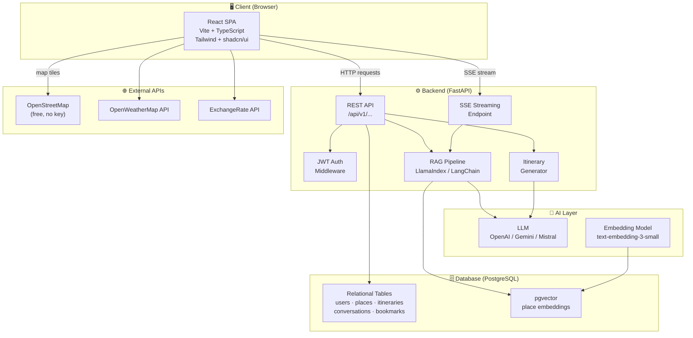
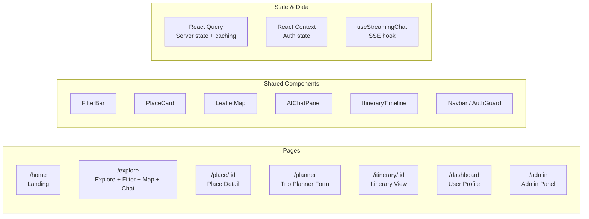
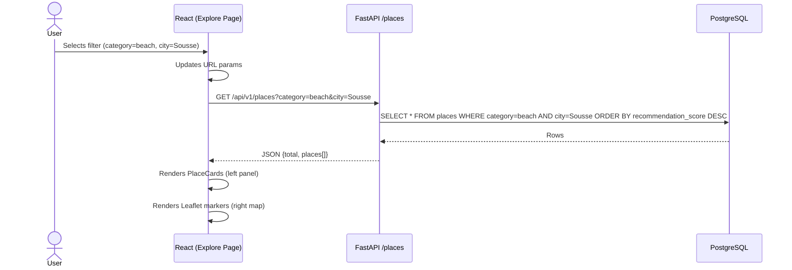
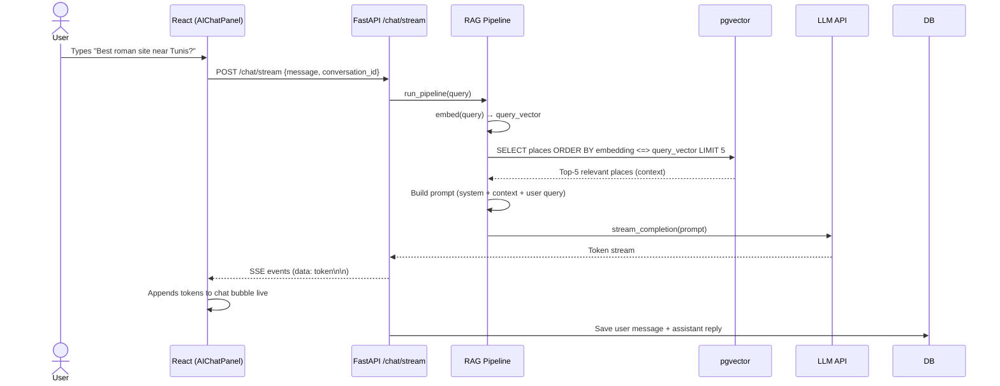
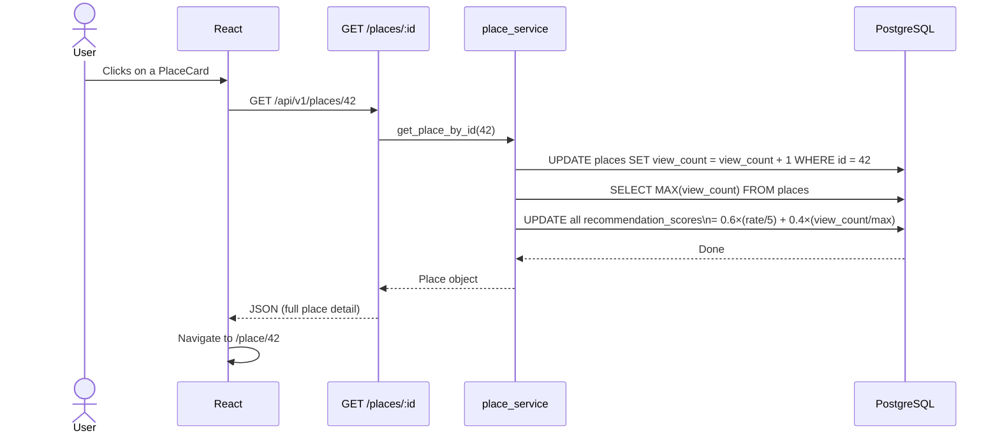
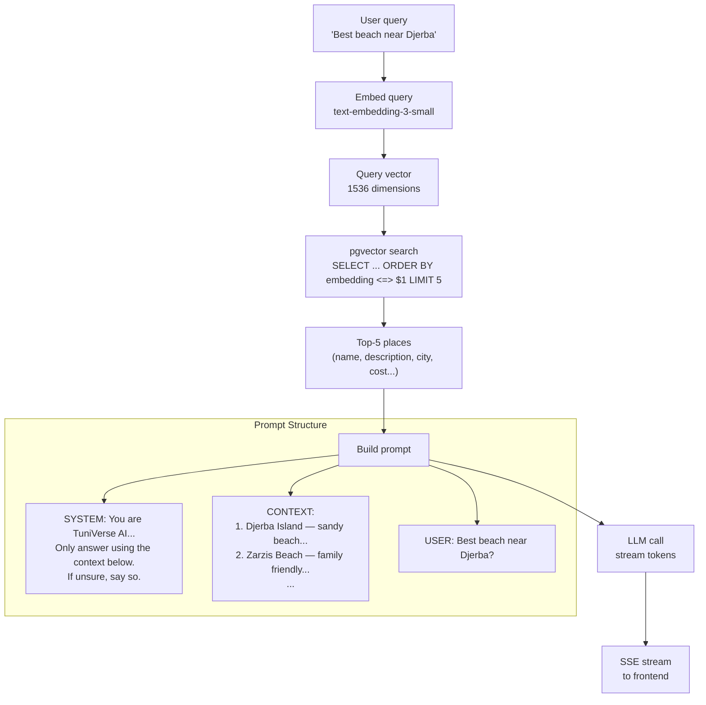
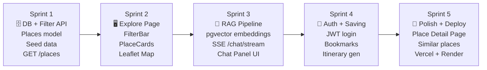

# 🏛️ TuniVerse — System Design

---

## 1. High-Level Architecture



---

## 2. Architecture Style

| Decision | Choice | Why |
|---|---|---|
| **Pattern** | Monolith (MVP) | Simpler to build, deploy, debug — split into services in v2 |
| **API style** | REST + SSE | REST for CRUD, SSE for streaming chat responses |
| **Auth** | Stateless JWT | No server-side session storage needed |
| **Vector store** | pgvector (in Postgres) | Avoids a separate vector DB (Pinecone/Weaviate) for MVP |
| **Streaming** | SSE (Server-Sent Events) | Simpler than WebSockets for one-way LLM token streaming |
| **Frontend** | SPA (Single Page App) | Fast navigation, map stays alive between route changes |

---

## 3. Component Breakdown

### 3.1 Frontend



**Key frontend design decisions:**
- **React Query** handles all API calls, caching, and re-fetching — no manual `useEffect` for data fetching
- **React Router v6** with protected routes (AuthGuard wraps `/dashboard`, `/admin`)
- **Filter state lives in the URL** (`/explore?category=beach&city=Sousse`) — shareable links, back-button works
- **Map and chat panel share state** — highlighted place IDs flow through React Context

---

### 3.2 Backend Layer Structure

```
backend/app/
│
├── api/v1/              ← Route handlers (thin layer — no business logic)
│   ├── places.py        GET /places, GET /places/:id, GET /places/:id/similar
│   ├── chat.py          POST /chat/stream  (SSE)
│   ├── itineraries.py   POST /itineraries, GET /itineraries/:id
│   ├── auth.py          POST /auth/register, POST /auth/login
│   ├── bookmarks.py     POST/DELETE /bookmarks
│   └── admin.py         CRUD /admin/places
│
├── services/            ← Business logic
│   ├── place_service.py     filter, fetch, score recomputation
│   ├── chat_service.py      RAG retrieval + LLM call
│   ├── itinerary_service.py itinerary generation via LLM
│   └── auth_service.py      JWT creation, password hashing
│
├── rag/                 ← RAG pipeline
│   ├── embedder.py      text → vector (embedding model)
│   ├── retriever.py     vector similarity search against pgvector
│   └── pipeline.py      query → retrieve → prompt → stream
│
├── models/              ← SQLAlchemy ORM models
├── schemas/             ← Pydantic request/response schemas
├── core/                ← config, security, dependencies
└── db/                  ← session, base, seed
```

---

## 4. Data Flows

### 4.1 Explore & Filter Flow



---

### 4.2 RAG Chatbot Flow



---

### 4.3 Recommendation Score Update Flow



---

## 5. RAG Pipeline — Deep Dive



**Guardrails built into the system prompt:**
- Must only use retrieved context — no fabrication
- Must refuse off-topic queries (politics, non-Tunisia topics)
- Must cite place names from context
- Must answer in English (MVP)

---

## 6. API Design

### Endpoints

| Method | Endpoint | Auth | Description |
|---|---|---|---|
| `GET` | `/health` | — | Health check |
| `GET` | `/api/v1/places` | — | List + filter places |
| `GET` | `/api/v1/places/:id` | — | Place detail (increments view_count) |
| `GET` | `/api/v1/places/:id/similar` | — | Similar places (same category/city) |
| `POST` | `/api/v1/chat/stream` | Optional | SSE streaming RAG chat |
| `POST` | `/api/v1/auth/register` | — | Create user account |
| `POST` | `/api/v1/auth/login` | — | Returns JWT token |
| `GET` | `/api/v1/itineraries/:id` | — | Get itinerary |
| `POST` | `/api/v1/itineraries` | Optional | Generate + save itinerary |
| `GET` | `/api/v1/bookmarks` | ✅ JWT | Get user bookmarks |
| `POST` | `/api/v1/bookmarks` | ✅ JWT | Add bookmark |
| `DELETE` | `/api/v1/bookmarks/:place_id` | ✅ JWT | Remove bookmark |
| `GET` | `/api/v1/admin/places` | ✅ Admin | List all places (admin) |
| `POST` | `/api/v1/admin/places` | ✅ Admin | Add new place |
| `PUT` | `/api/v1/admin/places/:id` | ✅ Admin | Update place |
| `DELETE` | `/api/v1/admin/places/:id` | ✅ Admin | Delete place |

### Standard Response Format
```json
// Success — list
{ "total": 42, "places": [ {...}, {...} ] }

// Success — single
{ "id": 1, "name": "El Jem", "city": "El Jem", ... }

// Error
{ "detail": "Place not found" }
```

---

## 7. Security Design

| Concern | Solution |
|---|---|
| **Password storage** | bcrypt hash — plaintext never stored |
| **Authentication** | JWT Bearer token (expires in 24h) |
| **Authorization** | Role-based: `user` vs `admin` checked in dependencies |
| **Input validation** | Pydantic schemas reject malformed requests automatically |
| **SQL injection** | SQLAlchemy ORM — no raw string queries |
| **CORS** | Restricted to `localhost:5173` (dev) and Vercel domain (prod) |
| **Prompt injection** | System prompt guardrails + input length cap |
| **API key exposure** | LLM key stored in `.env`, never sent to frontend |

---

## 8. Sprint-by-Sprint Build Order



---

## 9. What is NOT in the System (MVP Scope)

| Excluded | Reason |
|---|---|
| Redis / caching layer | Not needed at this scale |
| Message queue (Celery, RQ) | No async background jobs needed in MVP |
| WebSockets | SSE is sufficient for one-way LLM streaming |
| Docker | MVP runs locally |
| FR / AR multilingual | Deferred to v2 |
| Payment / booking | Out of scope entirely |
| Native mobile app | Web-only |
| Separate vector DB (Pinecone) | pgvector handles it at MVP scale |
