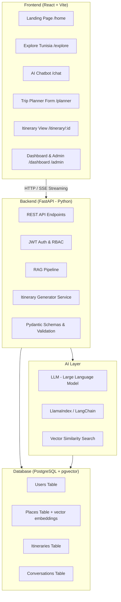
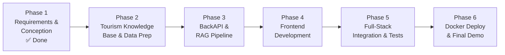

# 🌍 TuniVerse — Project Overview & Build Guide

> **Institution:** ENET'Com (École Nationale d'Électronique et des Télécommunications de Sfax)
> **Module:** TP Développement Web Dynamique | **Class:** 2nd Year IDSD — Group 2IDSD2
> **Team:** Ali Kchaou & Racem Trabelsi | **Deadline:** 31/10/2026

> [!IMPORTANT]
> **MVP Scope** — The current build targets a Minimum Viable Product (MVP).
> - 🌐 **English only** (FR/AR multilingual support deferred to v2)
> - 🐳 **No Docker** — services run locally without containerization
> - 🗄️ **Database hosted on Supabase** — shared cloud PostgreSQL, both team members connect to the same instance
> - All other features below apply unless marked *(v2)*

---

## 🧠 What is TuniVerse?

**TuniVerse** is an **AI-powered, multilingual tourism web platform** for Tunisia. Think of it as a smart virtual travel assistant that:
- Answers questions about Tunisian destinations using an **AI chatbot** (grounded with real data via RAG)
- **Automatically generates personalized day-by-day travel itineraries** based on your preferences
- Lets you **browse and filter Tunisian attractions** (monuments, beaches, museums, restaurants)
- Shows everything on **interactive maps**
- Supports **English, French, and Arabic** (with RTL layout for Arabic)

---

## 🎯 The Problem It Solves

Tourists planning a trip to Tunisia face:
- Fragmented, outdated info scattered across blogs and social media
- Generic AI chatbots that **hallucinate** prices, hours, or unrealistic routes
- No unified platform for multilingual, grounded, domain-specific travel guidance

---

## 👥 Actors / User Roles

| Actor | Permissions |
|---|---|
| **Visitor** (unauthenticated) | Browse attractions, use chatbot, generate preview itineraries |
| **Registered Tourist** | Save itineraries, bookmark places, export PDFs, persist chat history |
| **Administrator** | CRUD on tourism knowledge base, trigger vector re-indexing |
| **AI/RAG Engine** (system) | Semantic retrieval, multilingual response generation, structured JSON itineraries |

---

## 📋 Features

### Core Features (Must-Have)
| Ref | Feature | Description |
|---|---|---|
| F01 | **Multilingual RAG Chatbot** | AI assistant answering in EN/FR/AR using the tourism knowledge base |
| F02 | **Personalized Itinerary Generator** | Day-by-day planner based on region, duration, budget, interests |
| F03 | **Explore Tunisia Directory** | Searchable catalog of attractions with metadata cards |
| F04 | **Interactive Map Visualizer** | Leaflet/OpenStreetMap map with attraction pins & daily route lines |
| F05 | **User Auth & Saved Trips** | JWT login/register, saved itineraries, bookmarks, chat history |
| F06 | **Admin Panel / Knowledge Base** | CRUD for tourism entries + vector embedding re-indexing |

### Secondary Features
- 📄 **PDF Export** of itineraries as formatted travel guides
- 🌤️ **Live Weather** integration per region
- 💱 **Currency Converter** (TND / EUR / USD)
- 🗺️ **Map Synchronization** connecting daily stops geographically
- 🌐 **FR / AR + RTL multilingual support** *(v2 — deferred from MVP)*

### Out of Scope
- ❌ Online payments / hotel booking
- ❌ Native iOS / Android apps

---

## 🏗️ Architecture



---

## 🗄️ Database Design

### Entities
| Entity | Key Fields |
|---|---|
| **User** | id, name, email, password_hash, role (visitor/admin) |
| **Place** | id, name, region, category, description, cost, GPS coords, **embedding** (vector) |
| **Itinerary** | id, user_id, title, duration, budget_tier, places (day-by-day JSON) |
| **Conversation** | id, user_id, messages[], created_at |

### Relationships
- **User → Itinerary**: 1:N (one user, many saved itineraries)
- **Itinerary ↔ Place**: M:N (an itinerary has many places, organized by day)
- **User → Conversation**: 1:N (one user, many chat sessions)

---

## 🛠️ Full Tech Stack

| Layer | Technology |
|---|---|
| **Frontend** | React (Vite), TypeScript, Tailwind CSS, shadcn/ui |
| **Backend** | Python, FastAPI |
| **Database** | **Supabase** (hosted PostgreSQL 19 + pgvector extension) |
| **AI / RAG** | LLM + LlamaIndex or LangChain |
| **Maps** | Leaflet.js / OpenStreetMap |
| **Auth** | JWT + bcrypt/pwdlib (password hashing) |
| **i18n** | ~~react-i18next (EN / FR / AR + RTL)~~ — **MVP: English only** |
| ~~**Containerization**~~ | ~~Docker + Docker Compose~~ — **MVP: not needed, run locally** |
| **Frontend Deploy** | Vercel |
| **Backend Deploy** | Render |
| **API Docs** | Swagger UI (OpenAPI, auto-generated by FastAPI) |
| **Version Control** | Git + GitHub |

---

## 📄 Pages / Navigation

| Route | Page | Access |
|---|---|---|
| `/home` | Landing Page — hero, language switcher, featured regions | Public |
| `/explore` | Explore Tunisia — filterable attraction catalog | Public |
| `/chat` | AI Chatbot — streaming multilingual chat + source cards | Public / Auth |
| `/planner` | Trip Planner Form — wizard for region, duration, budget | Public / Auth |
| `/itinerary/:id` | Itinerary View — day-by-day schedule + map + PDF export | Public (preview) / Auth (save) |
| `/dashboard` | User Profile — saved trips, bookmarks | Authenticated |
| `/admin` | Admin Panel — CRUD knowledge base + re-indexing | Admin only |

---

## 🗂️ Current Project Structure (Scaffolded, not yet implemented)

```
TuniVerse/
├── backend/
│   ├── app/
│   │   ├── api/v1/           ← API route handlers (empty)
│   │   ├── core/             ← config, security, dependencies (empty)
│   │   ├── db/               ← DB session, base model (empty)
│   │   ├── middleware/       ← logging middleware (empty)
│   │   ├── models/           ← SQLAlchemy ORM models (empty)
│   │   ├── rag/              ← RAG pipeline (empty)
│   │   ├── schemas/          ← Pydantic schemas (empty)
│   │   ├── services/         ← Business logic (empty)
│   │   └── main.py           ← FastAPI app entry point
│   ├── alembic/              ← DB migrations
│   ├── tests/                ← Backend tests
│   ├── Dockerfile
│   └── requirements.txt
├── frontend/
│   └── src/
│       ├── components/       ← shared + UI components
│       ├── config/           ← API config
│       ├── hooks/            ← useStreamingChat hook
│       ├── i18n/             ← EN/FR/AR locale files
│       ├── pages/            ← Admin, Chat, Dashboard, Explore, Home, Itinerary, Planner
│       ├── router/           ← React Router config
│       ├── types/            ← TypeScript types
│       └── utils/            ← constants
├── data/                     ← Tourism dataset files (to be populated)
├── docker-compose.yml
└── .env.example
```

> [!WARNING]
> **All source files are currently empty placeholders.** The structure is scaffolded but no logic has been implemented yet. Everything needs to be built from scratch.

---

## 🚀 Development Phases



| Phase | Activities | Deliverable |
|---|---|---|
| ✅ 1 | Requirements, DB schema, wireframes | This document (Cahier des Charges) |
| 🔲 2 | Collect & structure Tunisian tourism data, generate vector embeddings | Populated Supabase DB (PostgreSQL + pgvector) |
| 🔲 3 | FastAPI REST endpoints, JWT auth, RAG pipeline, itinerary service | Functional backend with Swagger docs |
| 🔲 4 | React pages: Landing, Explore, Chat, Planner, Map, Dashboard | Multilingual React app |
| 🔲 5 | Connect frontend ↔ backend, multilingual RTL, RAG accuracy tests | Full integrated prototype |
| 🔲 6 | **Deploy** frontend on Vercel + backend on Render (no Docker needed for MVP) | Live deployed platform |

---

## ✅ What You Need to Build (Priority Order)

### 1. Tourism Data Collection (Phase 2)
- Collect structured data for Tunisian attractions: name, region, category, GPS, cost, description
- Generate **vector embeddings** for each entry (using an embedding model)
- Populate the **Supabase** `places` table (use Supabase Table Editor or the seed script)

### 2. Backend (Phase 3)
- Set up **FastAPI** app with Alembic migrations
- Implement **SQLAlchemy models** (User, Place, Itinerary, Conversation)
- Build **JWT auth** (register, login, refresh, RBAC)
- Build **RAG pipeline** with LlamaIndex/LangChain → pgvector retrieval → LLM generation
- Build **Itinerary Generator** service (structured JSON output from LLM)
- Implement **SSE streaming** for chatbot responses
- Build **Admin CRUD** API for knowledge base management
- Write **Pydantic schemas** for all endpoints

### 3. Frontend (Phase 4)
- Build all 7 pages with React + TypeScript + Tailwind + shadcn/ui
- **MVP: English only** — no i18n library needed yet; hardcode English strings
- Integrate **Leaflet.js** maps with attraction pins
- Build **streaming chat UI** (SSE consumer hook already scaffolded in `useStreamingChat.ts`)
- Build **trip planner wizard** form
- Build **PDF export** using a library like `react-pdf` or `jspdf`
- *(v2)* Add react-i18next with FR/AR + RTL layout switching

### 4. Integration & Testing (Phase 5)
- Connect all API calls from frontend to backend
- Validate RAG grounding (no hallucinations on prices/hours)
- Run functional tests (backend `tests/` folder)

### 5. Deployment (Phase 6)
- Deploy frontend on **Vercel** (push to GitHub, connect repo)
- Deploy backend on **Render** (Python web service, set env vars)
- *(v2)* Containerize with Docker Compose for reproducible local dev

---

## 🔑 Key APIs / External Services You'll Need

| Service | Purpose |
|---|---|
| **OpenAI / Gemini / Mistral / Ollama** | LLM for chatbot responses |
| **OpenAI Embeddings / sentence-transformers** | Generate vector embeddings for RAG |
| **OpenWeatherMap API** | Real-time weather per region |
| **ExchangeRate API** | TND/EUR/USD currency conversion |
| **OpenStreetMap + Leaflet** | Free maps (no API key needed) |
